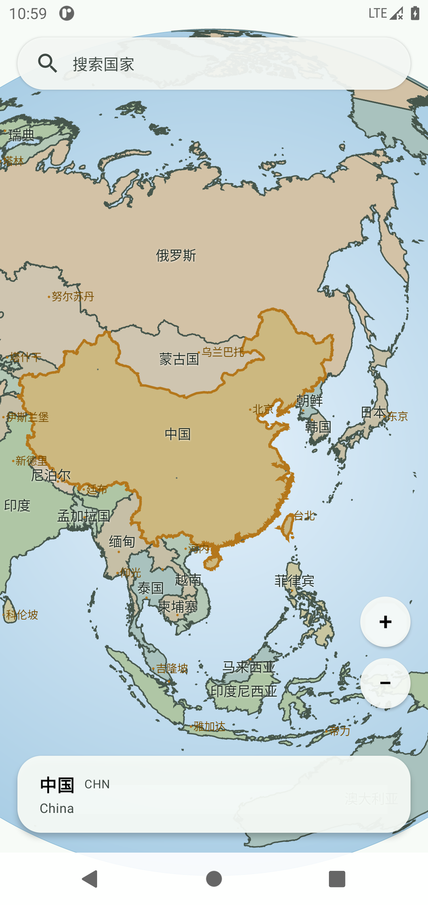
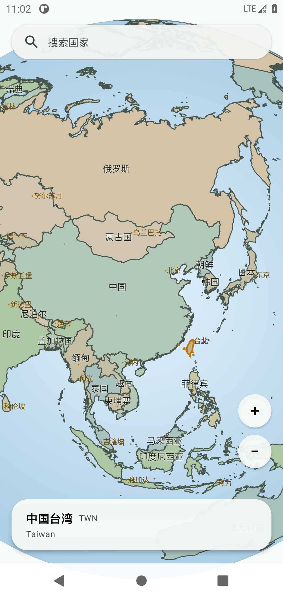

# WorldMap 世界地图

一个离线可用的国家层面世界地图 App：把地球装在手里，拖动旋转、双指缩放查看任意国家，点击或用中文/英文搜索都能定位到目标国家并高亮。

## 功能

- 拖动地球旋转视角，双指捏合缩放，最大 10 倍。
- 每个国家都有清晰国界描边，相邻国家配色不同，边界一眼可辨。
- 地图上标注中文国名，随缩放分级显示：全球视野只显示大国，放大后小国名称陆续出现。
- 点击国家高亮并显示国家名，点空白处取消选择。
- 搜索国家（支持中文、English、ISO 代码），自动飞到该国并选择合适的视野倍率；小国定位倍率更高。
- 保留搜索历史，可一键清空。
- 更深的缩放档位会显示更多城市名。
- 支持浅色/深色主题，跟随系统。

## 截图

| 选中中国：台湾一起高亮 | 单独点台湾：只有台湾高亮 |
| --- | --- |
|  |  |

## 构建

需要 JDK 17、Android SDK（compileSdk 36），包名 `com.sqz.worldmap`，最低支持 Android 8.0（API 26）。

```bash
./gradlew :app:assembleDebug            # 调试包
./gradlew :app:testDebugUnitTest        # 单元测试
./gradlew :app:assembleRelease          # 发布包（未签名）
```

Windows 下用 `gradlew.bat`。生成包位于 `app/build/outputs/apk/`。

## 数据来源与许可

国家边界与城市数据来自 [Natural Earth](https://www.naturalearthdata.com/)（1:10m 国家边界、1:110m 城市点），属于公有领域（Public Domain），可自由使用。应用完全离线，不联网、不收集任何数据。

## 已知限制

- 面积很小的国家在下述情况仍可能看不到轮廓：如马尔代夫环礁、加勒比微型岛国，受最大 10 倍缩放限制只能显示为小点。
- 全球视野下，靠近地球边缘（地平线附近）的国名标签会被压缩并可能相互遮挡，程序会按优先级隐藏部分标签。
- 1:10m 数据对极小的海外属地（如部分太平洋小岛）仍只是一两个轮廓点，细节有限。
